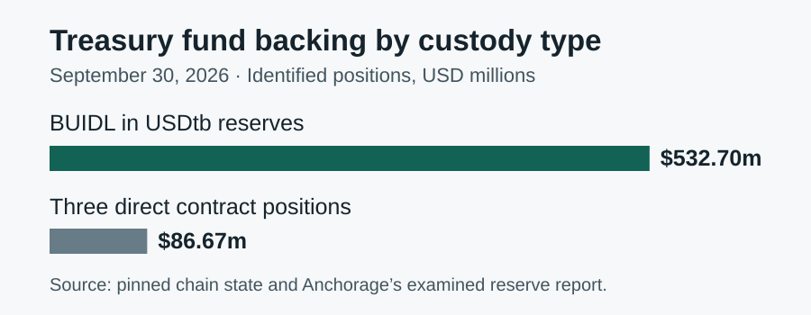

# Allow-list leakage: direct holdings leave the 5% cutoff unresolved



This study measures indirect exposure to five tokenized Treasury funds through assets available on secondary markets. It combines historical chain state and issuer disclosures to bound the direct-contract share on September 30, 2026. It also measures the effect of including BUIDL in bank custody as backing for USDtb.

## Results

| Measure at September 30, 2026 | Finding |
| --- | --- |
| Direct contract holdings | Three positions backed mTBILL, USD0 and USST, totaling **$86.67 million**. The conditional **0.94%–62.20%** range spans the **5%** cutoff. [Direct-contract test](docs/RESULTS.md#direct-contract-test) |
| Including bank reserve custody | Adding **$532.70 million** of BUIDL in USDtb reserves raises the lower bound to **6.74%**. It falls to **2.63%** without the Solana and Aptos balances reported by Anchorage. [Reserve custody](docs/RESULTS.md#custody-inclusive-backing) |

## How it works

`scripts/holder_audit.py` ranks observed holders using month-end balances and bounds each missing holder's possible share. `scripts/kill_test.py` values eligible positions and computes the bounds using the five funds' modeled supply ceilings. The method uses pinned quote, inventory and token-control observations to assess secondary access.

## Run it

Use Python 3.14.8 with its standard library. The offline calculation and 19 tests require no install, credentials or network access.

```sh
python3 -m unittest discover -s tests -v
sha256sum -c evidence/SHA256SUMS
python3 scripts/holder_audit.py
python3 scripts/kill_test.py
```

## Repository layout

- `docs/` contains the findings, method, source register, figures and review record.
- `evidence/` contains the factual observations and checksum manifest.
- `posts/` contains draft text and its supporting evidence.
- `scripts/` contains the calculations and read-only source retrieval tools.
- `tests/` contains offline tests.

## Documentation

[Public repository](https://github.com/RahilBhavan/rwa-allowlist-leakage)

- [Results](docs/RESULTS.md) traces the bounds and sensitivities to their inputs.
- [Holder coverage](docs/HOLDERS.md) shows which balances and ranks are established by chain.
- [Fund access and protocol dependencies](docs/REACH.md) maps who can obtain exposure and what depends on issuer redemptions.
- [Method](docs/METHOD.md) explains the calculations and links to pinned replay commands.
- [Source register](docs/SOURCES.md) records the provenance, hashes and retrieval instructions.
- [Decisions](docs/DECISIONS.md) explains changes to the method after review.
- [Quality review](docs/QUALITY.md) records the independent review of the research snapshot.

## Sources

Sources include issuer disclosures and raw measurements from public RPC calls pinned to September 30, 2026. The OUSG denominator also uses adjacent issuer marks through October 4. The source register identifies the relevant publisher documents by URL and full-file SHA-256. Published fixtures are checksummed separately. [Source register](docs/SOURCES.md)

## Scope and limits

- This is independent research. The project has no affiliation with the issuers or protocols studied.
- The reported positions are economic backing. Fund shareholder rights and primary redemption eligibility follow separate issuer terms.
- Missing holder coverage and denominator assumptions leave the direct share unresolved. Historical quotes show access at the tested sizes. Market depth at size and losses under a redemption pause remain unknown.

## License

The project's original code is licensed under the [MIT License](LICENSE). Third-party filings, data and other source materials retain their own terms.

Part of [Rahil Bhavan's projects](https://github.com/RahilBhavan).
