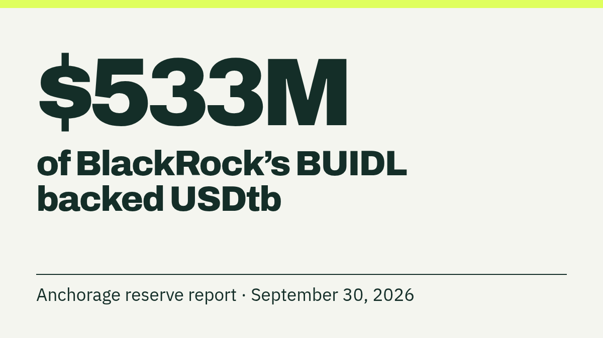

# Allow-list leakage: $533 million of BUIDL backed USDtb



How much of five tokenized Treasury funds backed tokens that traded on open markets? For the September 30, 2026 snapshot, Anchorage reported about **$533 million of BUIDL backing USDtb**, which had a quoted Curve market, and we traced **$86.67 million** more to three direct contract positions. [USDtb evidence](docs/RESULTS.md#usdtb-bank-custody) · [Direct contracts](docs/RESULTS.md#direct-contract-test)

## Results

- **Direct contracts.** The conditional range was **0.94%–62.20%**, leaving the **5%** cutoff unresolved. Removing the dust-only mTBILL route reduced the measured direct amount to **$15.03 million**. [Direct test and sensitivity](docs/RESULTS.md#direct-contract-test)
- **Including bank reserves.** Backing totaled **$619.37 million**, at least **6.74%** under the broader supply model. Of that backing, **$241.93 million** had pinned balance evidence and **$377.43 million** came from the Solana and Aptos legs of Anchorage’s examined report. [Custody-inclusive backing](docs/RESULTS.md#custody-inclusive-backing)
- **BUIDL supply sensitivity.** A deployment-based scenario narrowed the direct range to **1.45%–41.61%**, still spanning the cutoff. [BUIDL deployment scenario](docs/RESULTS.md#buidl-deployment-scenario)

## How it works

`scripts/holder_audit.py` ranks observed holders using month-end balances and bounds each missing holder's possible share. `scripts/kill_test.py` values eligible positions and computes the bounds using the five funds' modeled supply ceilings. The method uses pinned quote, inventory and token-control observations to assess secondary access.

## Run it

Use Python 3.10 or newer with its standard library. The offline calculation and 22 tests require no package install, credentials or network access. Verified on Python 3.10.21 and 3.14.8.

```sh
python3 -m unittest discover -s tests -v
sha256sum -c evidence/SHA256SUMS
python3 scripts/holder_audit.py
python3 scripts/kill_test.py
python3 scripts/check_post_card.py
```

Optional live checks use keyless RPCs and Poppler’s `pdftotext`. [Live replay and PDF verification](docs/METHOD.md#repair-fixtures-and-replay)

## Repository layout

- `docs/` contains the findings, method, source register, figures and review record.
- `evidence/` contains the factual observations and checksum manifest.
- `posts/` contains draft text and its supporting evidence.
- `scripts/` contains the calculations and read-only source retrieval tools.
- `tests/` contains offline tests.

## Documentation

- [Results](docs/RESULTS.md) traces the bounds and sensitivities to their inputs.
- [Holder coverage](docs/HOLDERS.md) shows which balances and ranks are established by chain.
- [Fund access and protocol dependencies](docs/REACH.md) maps who can obtain exposure and what depends on issuer redemptions.
- [Method](docs/METHOD.md) explains the calculations and links to pinned replay commands.
- [Source register](docs/SOURCES.md) records the provenance, hashes and retrieval instructions.
- [Decisions](docs/DECISIONS.md) explains changes to the method after review.
- [Quality review](docs/QUALITY.md) records the independent review of the research snapshot.

## Sources

Sources include issuer disclosures and raw measurements from public RPC calls pinned to September 30, 2026. The OUSG denominator also uses adjacent issuer marks through October 4. The source register identifies the relevant publisher documents by URL and full-file SHA-256. Published fixtures are checksummed separately. [Source register](docs/SOURCES.md)

**Prior art and contribution.** BIS Bulletin 115 identifies the gap between restricting direct fund holdings and allowing indirect exposure. Tümer and Mafrur classify Ethereum transfers and intermediary balances. RWA.xyz tracks deployments and holder metrics, issuers publish fund and reserve figures, and protocol risk teams report collateral and borrowing within individual markets. This study links pinned positions to specific downstream tokens, tests secondary acquisition at the pin and maps how an issuer redemption pause could reach those tokens or stablecoin lenders. [Prior art comparison and sources](docs/RESULTS.md#prior-art-and-contribution)

## Scope and limits

- This is independent research. The project has no affiliation with the issuers or protocols studied.
- The reported positions are economic backing. Fund shareholder rights and primary redemption eligibility follow separate issuer terms.
- Missing holder coverage and denominator assumptions leave the direct share unresolved. Historical quotes show access at the tested sizes. Market depth at size and losses under a redemption pause remain unknown.

## License

The project's original code is licensed under the [MIT License](LICENSE). Third-party filings, data and other source materials retain their own terms.

Part of [Rahil Bhavan's projects](https://github.com/RahilBhavan).
