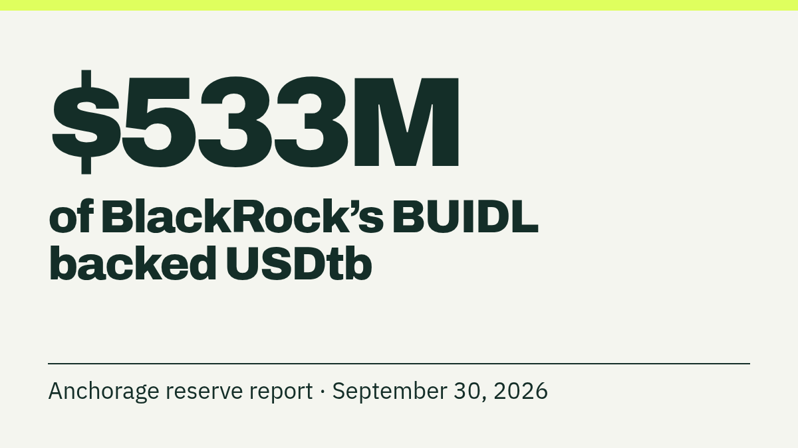

# Standalone X drafts

Drafts for Rahil’s tokenization audience. The card is an original draft pending design approval.

## USDtb reserves

> On September 30, 2026, Anchorage reported that $533M of BlackRock’s BUIDL backed USDtb. USDtb had a quoted Curve market, giving DEX buyers exposure to the stablecoin’s reserves.

[USDtb reserve evidence and Curve quote](https://github.com/RahilBhavan/rwa-allowlist-leakage/blob/main/docs/RESULTS.md#usdtb-bank-custody) · [Anchorage’s examined report](https://learn.anchorage.com/09.30.26_USDtb-Stablecoin-Attestation-Report-signed.pdf)

[Card source](cards/usdtb-buidl.html) · [Card evidence and checks](cards/usdtb-buidl.json)

## The mTBILL market

> On September 30, 2026, a Midas vault held USTB for mTBILL redemptions. The only open mTBILL route this study found at that snapshot was a dust-size Uniswap quote with a 79% pool fee.

[Midas vault and quote](https://github.com/RahilBhavan/rwa-allowlist-leakage/blob/main/docs/RESULTS.md#midas-mtbill)

## Usual’s collateral treasury

> On September 30, 2026, Usual’s treasury held $14.03M of Circle’s USYC as collateral for USD0. The collateral contract was configured to draw USYC from that treasury for redemptions.

[Usual’s treasury balance and contract linkage](https://github.com/RahilBhavan/rwa-allowlist-leakage/blob/main/docs/RESULTS.md#usual-usd0-collateral)

## Flux lending

> On September 30, 2026, Flux let users lend USDC against a debt book that could include loans secured by OUSG. For a USDC lender, recovery after a borrower default can depend on whether an eligible liquidator can sell the OUSG.

[Pinned Flux controls and credit path](https://github.com/RahilBhavan/rwa-allowlist-leakage/blob/main/docs/RESULTS.md#gated-collateral-and-open-lending)

## Card verification

Run `python3 scripts/check_post_card.py` from the repository root. It checks the exact exported PNG, the visible-text word count, the amount and date against the source transcription, and the links from the draft. The visual receipt records the layout, palette and feed-size checks. The editable HTML uses Archivo Variable and IBM Plex Sans Regular from the selected Proofline kit. To re-render, place those font files in a sibling `fonts/` directory beside a scratch copy of the HTML. Open the copy with Chromium at 1200 × 675, device scale 1, wait for fonts to load and capture the viewport. Fonts are linked as dependencies and kept outside the public export. [Archivo](https://github.com/Omnibus-Type/Archivo) · [IBM Plex](https://github.com/IBM/plex)
